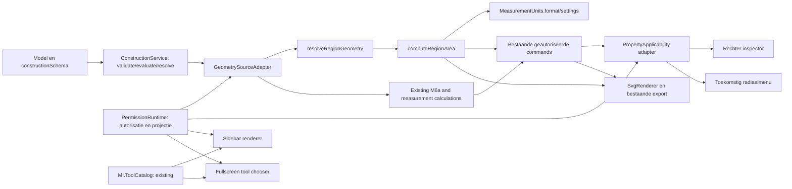

# CORE-1 — Herbruikbare geometrie-, eigenschappen- en gereedschapsarchitectuur

Versie: 1.2.1 — main-integratieaddendum op historische CORE-1 audit (2026-10-15)
Status: CORE-1-basisanalyse en het branchcheckpoint blijven historisch; UI-RADIAL-9/REG-2 zijn met PR #12 naar `main` gemerged (referentie `63ab45acc7`). Deze documentatieaanvulling heeft geen productiecode of tests aangepast.
Basis: GitHub `main` op `f4039842c44885d739b624d9d67bbfdd75d2394e`; omvat M6b `b5e693f`, G-TRI1, UI-T1 en de bestaande `MI.ToolCatalog`
Normatieve context **voor huidig radiaalmenu**: [UI-RADIAL-9-CONTRACT-DRIVEN.md](UI-RADIAL-9-CONTRACT-DRIVEN.md) en [AGENTS.md](../AGENTS.md). De [geometrie-/UI-architectuur uit 2026-10-13](GEOMETRY-TOOLS-REGIONS-RADIAL-ARCHITECTURE-v1.0.0.md) en het [historische uitvoeringsplan](CODEX-EXECUTION-PLAN-TOOLS-RADIAL-REGIONS-TRIANGLE-v1.0.0.md) blijven referenties voor de oorspronkelijke CORE-1-context, maar zijn niet langer normatief voor de huidige radiale interactie.

## Main-integratie en goedgekeurde M8-ontwerpen (2026-10-15)

De oorspronkelijke CORE-1-secties waren gecontroleerd op `main` bij `f403984`; de DOC-RADIAL-1-aanvulling beschreef de toenmalige ontwikkelbranch. Deze historische teksten blijven voor herleidbaarheid staan. **Sinds PR #12** bevindt de gedeelde contextuele constructiearchitectuur zich ook op `main`, geverifieerd bij commit `63ab45acc7`. Dit is geen nieuwe regressie- of browser-PASS.

De nieuwe [M8a — Ellipsen](M8a-ELLIPSEN-CONTRACT.md) en [M8b — Parallellogrammen](M8b-PARALLELLOGRAMMEN-CONTRACT.md) zijn **goedgekeurde ontwerpcontracten**, geen reeds bestaande API's. De implementatie blijft via `ConstructionService`, `ToolCatalog`, autorisatiemodel, document-/dependency-graaf en bestaande render-/exportpaden lopen. Let op: sectie 6 noemt nog de *historische* basis tot documentversie 7 / constructieschema 4. De huidige `main` ondersteunt via REG-2 documentversie 8, `regionSchema:1` en `constructionSchema:5`; latere M8-schemaversies zijn nog niet geïmplementeerd.

## DOC-RADIAL-1 — Actuele architectuurlaag (2026-10-14, voorrang voor radiale functies)

Dit document begon als **CORE-1-ontwerp/audit** op `main` bij commit `f403984`; die oorspronkelijke observaties en toekomstige API-voorstellen worden hieronder bewust niet herschreven. Het volgende is de daadwerkelijk geïmplementeerde **featurebranchlaag** op `codex/ui-radial-7-point-context-constructions`, niet een bewering over `main`.

| Verantwoordelijkheid | Huidige eigenaar/contract op featurebranch |
|---|---|
| Getypeerde bronrollen en matching | `ConstructionService.contract(kind).sourceRoles`, `referenceOptions` en `referencesForRole` |
| Contextueel bronplan | `ConstructionService.contextualPlans(object,kind)` retourneert een geldige `prefill`, `complete` of `placement`-mogelijkheid met bronreferenties en index; speciale flows zijn expliciet uitgesloten |
| Werkende gereedschappen | Eén `ToolCatalog` voor sidebar/fullscreen/radiale constructielijst; alleen `implemented` |
| Radiale UI | `editor-radial-properties.js`: selectiepresentation, categorieën, plannen als knoppen, geen eigen constructiegeometrie of objecttype-whitelist |
| Uitvoering | `EditorApp.startContextConstruction(toolId,objectId,planKey)` met hercontrole van keuze/rechten, daarna bestaande `constructionClick` en `construction.create` |
| Rechten, revisies, opslag | Bestaande `PermissionRuntime`, commandvalidering, documentmodel, dependency graph, undo/redo, SVG/PNG |
| Eigenschappen en layout | Zwevende inspector via bestaande edit-commando's; géén permanente rechter kolom. Compact rechtsklikmenu met zes segmenten en sleepgreep |

**Betekenis voor nieuwe objecten:** voeg model-/source-role-ondersteuning toe in de normale geometrische services en registreer nieuwe tools in de bestaande catalogus; breid alleen het gedeelde service- of interactiecontract uit als een nieuwe bronrol, objectonderdeel of parameterplaatsing dat noodzakelijk maakt. Voeg **niet** voor elk objecttype een aparte radiale toolmapping of starter toe.

**Voor oudere tekst hieronder:** passages zoals `Toekomstig radiaalmenu`, `rechter inspector blijft staan`, of `UI-R1/R2 zijn nog niet gestart` slaan uitsluitend op de oude audit-/ontwerpstatus; de v1.2.0-aanvulling en UI-RADIAL-9 hebben voor de huidige implementatie voorrang. Eigenschappenvelden en capabilityregels mogen later verder gecentraliseerd worden, maar de bestaande radiale UI is al functioneel; doe geen brede refactor zonder opdracht.

**Validatiestatus:** gebruiker bevestigde UI-RADIAL-7/8/9 in de browser functioneel; automatische regressietests zijn in deze uitvoeringsreeks op verzoek niet gedraaid. UI-RADIAL-1–9 zijn niet naar `main` gemerged. Zie roadmap v2.8.0 voor statusadministratie.

---

## 1. Doel en grens

CORE-1 ontwerpt één samenhangende servicegrens voor bestaande en toekomstige geometrische berekeningen, getypeerde gebiedsoppervlakten, eigenschappenacties en gereedschapsdefinities. Het is een architectuurpoort. Dit document implementeert geen service, regio-object, radiaalmenu, toolgroepering, opslagmigratie of nieuwe permissie.

De applicatie behoudt één geometrische documentwaarheid, één constructiegraaf, de bestaande command-/geschiedenispaden en de bestaande renderer- en exportpaden. Berekeningen zijn modelruimteberekeningen; UI-componenten leveren geen geometrische waarheid en schrijven nooit rechtstreeks naar het documentmodel.

## 2. Codeaudit: hergebruik en ontbrekende adapters

De audit is gebaseerd op de bestanden op de hierboven genoemde `main`-commit. De genoemde functies zijn bestaande implementaties, geen onderdelen die door CORE-1 opnieuw moeten worden gebouwd.

| Bestaande code | Herbruikbaar contract | CORE-1-besluit |
|---|---|---|
| `construction-service.js`: `ConstructionService.referencesForRole`, `validateReferences`, `evaluate`, `resolve`, `point`, `line`, `contract` | Getypeerde bronrollen, bronvalidatie, topologische herberekening, resolved geometry en recoverable ongeldige constructies. `triangle` accepteert alleen een `polygon` met exact drie vertices; M6a en M6b gebruiken deze rol. `triangleFromPoints` is de G-TRI1-koppeling van drie afzonderlijke punten naar één afhankelijke polygon. | Blijft eigenaar van construction-recepten en afhankelijkheden. Geen tweede graaf of triangle-resolver. Regio-recepten worden later in dezelfde service en dependency graph geregistreerd. |
| `construction-service.js`: interne `triangleCenter`; geëxporteerde `triangleCenterKinds`, `triangleInvariantStatus` | Genormaliseerde lokale driehoekscoördinaten, degeneratiegrens `1e-12`, invariantcontroles en statussen waaronder `DEGENERATE_TRIANGLE`, `NON_FINITE_RESULT` en `COORDINATE_LIMIT`. | Referentie voor numerieke schaalbehandeling en teststijl; niet kopiëren naar gebieds- of UI-code. De berekeningshelper zelf is intern en geen publieke adapter-API. |
| `polygon-geometry.js`: `validate`, `edges`, `contains`, `anchor` | Begrensde validatie van eenvoudige polygonen, zelfsnijdingscontrole, randverzameling, punt-in-polygoon en labelanker. Validatie accepteert 3–256 vertices en modelcoördinaten binnen `1e12`. | Hergebruik voor bestaande polygonen en de polygonvariant van een toekomstig gebied. Introduceert geen sector-/segmentcontour en is geen oppervlakte-formatter. Behoud de bestaande aparte M6a-degeneratiebehandeling. |
| `measurement-geometry.js`: `MeasurementGeometry.value`, `edges`, `anchors`; `MeasurementUnits.figureValue`, `format`, `settings` | Bestaande lengte-/hoekberekeningen, figuuroppervlakte voor cirkels en polygonen, perimeter en documenteenheden. `format(value, 'area', settings)` schaalt eenmaal met `scale²`, voegt `²` toe en past de ingestelde precisie toe. | Blijft de numerieke en presentatiebasis voor bestaande metingen. `construct:area` en bestaande oppervlakteweergave mogen niet worden gedupliceerd of gewijzigd om nieuwe regio's te ondersteunen. |
| `model.js` en `construction-service.js`: constructierecept- en JSON-validatie | Recepten, dependencies en bestaande documentcompatibiliteit worden gevalideerd in het bestaande model-/constructiepad. | Nieuwe region-recepten horen, indien later goedgekeurd, in dit pad; geen afzonderlijk region-document of bypass bij import/replay. |
| `permission-runtime.js`: `sourceAllowed`, `getObjectCapabilities`, `getAllowedTools`, `object.setProperties`-validatie en command-autorisatie | Rechten worden op commando-/bron- en objectniveau afgedwongen. Runtime-projectie redigeert restricted inhoud. `sourceAllowed` controleert onder meer lees-/displayrecht, beschikbaarheid en expliciete toegestane bronproperties. | Blijft de enige autoriteit. Nieuwe adapters consumeren runtime-capabilities en projecties; ze verlenen zelf geen rechten en vervangen commit-time validatie niet. |
| `tool-catalog.js`: `MI.ToolCatalog.build/create/list/getTool/getSplit`; `editor.js`: `toolCatalog`, `commonInspector`, `setCommonProperty`, capability- en fullscreenrendering; `editor.html`: `data-tool-category`, `data-tool` en inert placeholders | De bestaande `MI.ToolCatalog` bouwt één genormaliseerde catalogus uit toolmarkup, valideert unieke categorie-/tool-ID's en splitgroepen en voedt sidebar en fullscreen. `planned` entries blijven inert en hebben geen tool- of command-ID. De bestaande inspector en commands blijven toepasbaarheid en writes afhandelen. | Hergebruik `MI.ToolCatalog`; introduceer geen concurrerende `buildToolCatalog` of tweede tooldefinitie. Een toekomstige `PropertyApplicability` is alleen een presentatie-adapter, geen autorisatie- of commandlaag. Bestaande M6-, G-TRI1- en tool-ID's blijven stabiel. |

### Wat niet al bestaat

- `PolygonGeometry` valideert polygonen, maar bouwt geen getypeerde sector- of segmentgeometrie.
- `MeasurementUnits.figureValue` kent de oppervlakte van een hele cirkel en een polygon, maar is geen getypeerde oppervlaktefunctie voor sectoren en segmenten.
- `EditorApp.commonInspector` berekent toepasbaarheid, gemengde waarden en commandestatus in UI-rendercode. Er is geen gedeelde pure eigenschappencatalogus voor inspector en toekomstig radiaalmenu.
- `MI.ToolCatalog` bestaat en wordt al door `EditorApp` gedeeld voor sidebar en fullscreen. De catalogus leest huidige markup; splits en command-/policyafhandeling blijven bij hun bestaande eigenaren. Er ontbreekt geen tweede catalogus, maar eigenschappen-toepasbaarheid is nog niet als gedeelde presentatieadapter uitgewerkt.

Daarom stelt CORE-1 geen nieuwe algemene geometrie-engine voor en bouwt het geen tweede catalogus. M6a/M6b en G-TRI1 blijven in `ConstructionService`; UI-T1 en fullscreen consumeren `MI.ToolCatalog`. Alleen als dunne toekomstige servicegrenzen blijven `GeometrySourceAdapter`, `resolveRegionGeometry`, `computeRegionArea`/`formatRegionArea` en `PropertyApplicability` over. Bestaande services blijven eigenaar van graph, policy, units, commands, geschiedenis en rendering.

## 3. Afhankelijkheidsgrenzen



De dependency graph blijft de plaats voor dynamische bronafhankelijkheden en herberekening. `resolveRegionGeometry` en `computeRegionArea` zijn zuivere berekeningen op een gevalideerde bronopname; zij muteren geen model en houden geen eigen cache bij. Commando's valideren iedere wijziging opnieuw. Inspector, radial menu, canvasrenderer, labels, SVG en PNG consumeren dezelfde berekende eigenschap via de bestaande projectie- en commandgrenzen.

## 4. Voorgestelde API-contracten

De interfaces hieronder zijn ontwerpcontracten; functienamen en modulegrenzen zijn voorstellen totdat dit ontwerp is geaccepteerd. Foutresultaten zijn expliciet en bevatten geen gevoelige brondata.

### 4.1 Geautoriseerde geometriebronnen

```js
GeometrySourceAdapter.resolve({
  role: 'point' | 'triangle' | 'circle' | 'polygon' | 'figure',
  references: [{ objectId, part?, index? }],
  context: authorizedCommandContext
})
// { ok: true, sources: readonly ResolvedSource[] }
// { ok: false, reasonCode: 'INVALID_REFERENCE' | 'SOURCE_UNAVAILABLE' |
//   'SOURCE_INVALID' | 'PERMISSION_DENIED' }
```

`context` is alleen intern samengesteld door het bestaande runtime-/commandpad. Het levert een bron uitsluitend nadat bronselectie- en read/display/source-rechten zijn gecontroleerd. De adapter:

- delegeert structurele rolcontrole aan `ConstructionService.validateReferences`/`referencesForRole` en gebruikt de reeds gereconstrueerde, actuele objecten uit `ConstructionService.resolve`;
- geeft voor `triangle` uitsluitend het bestaande `polygon`/exact-drie-vertices-contract terug; voor punten/onderdelen gebruikt hij de bestaande getypeerde `point`- en referentiesemantiek;
- retourneert een immutable snapshot in modelcoördinaten, met objectidentiteit alleen intern voor dependency-tracking; labels, bronwaarden en object-ID's worden niet naar UI-presentatiedata gekopieerd tenzij de bestaande projectie die informatie toestaat;
- berekent geen centrum, oppervlakte of rendering en past geen alternatieve policy toe;
- behandelt ontbrekende, ongeldige, verborgen of inmiddels niet-geautoriseerde bronnen als expliciete mislukking; een consumer mag geen eerder berekend resultaat blijven tonen na context-/permission-epochwijziging.

M6a vereist geen nieuwe triangle-adapter: de huidige `triangle`-rol, referentievalidatie en graafresolver voldoen al. De voorgestelde adapter is alleen nodig als dunne grens waar een toekomstige gebiedsberekening door een command-context geautoriseerde, getypeerde geometrie nodig heeft. Hij mag M6a niet omleiden of vervangen.

### 4.2 `resolveRegionGeometry`

```js
resolveRegionGeometry({ recipe, sources, limits })
// { ok: true, geometry: RegionGeometry }
// { ok: false, reasonCode: 'INVALID_REFERENCE' | 'SOURCE_INVALID' |
//   'DEGENERATE_REGION' | 'SELF_INTERSECTION' | 'NON_FINITE_RESULT' |
//   'COORDINATE_LIMIT' | 'UNSUPPORTED_REGION_KIND' }
```

`recipe` is een al gevalideerde, getypeerde regio-invoer. De canonieke receptnamen, bronvolgorde, JSON-velden en foutstatussen zijn nu vastgelegd in [REG-1-CONTRACT.md](REG-1-CONTRACT.md) §2–5. De drie types zijn:

- `polygonRegion`: een bestaande begrensde eenvoudige polygonbron; hergebruik `PolygonGeometry.validate`.
- `circleSectorRegion`: cirkelbron en twee richtingpuntreferenties met expliciet `extent: 'minor' | 'major'`.
- `circleSegmentRegion`: dezelfde typed circle-/richtingpointbronnen en sweepkeuze.

`RegionGeometry` bevat alleen eindige modelruimtepunt-/cirkelparameters, een discriminerend type en de gevalideerde contoursemantiek die de bestaande renderer later nodig heeft. Hij bevat geen SVG/DOM, pixelcoördinaten, geformatteerde getallen, objectmutaties of impliciete bronrechten. De service heeft vaste aantals-/dieptelimieten en gebruikt schaalbewuste lokale rekenstappen waar subtractie, cross-products of boogconstructie dat vereist. Elke teruggetransformeerde coördinaat wordt tegen de modelcoördinatenlimiet `1e12` gecontroleerd.

De area-functie interpreteert sweepwaarden volgens de vastgelegde REG-1 minor/major-conventie. Voor waarden rond `0`, `π` en `2π`, wrap over nul en samenvallende eindpunten levert de resolver de geometrie/status zoals REG-1 die definieert; geen consumer leidt betekenis af uit schermklikvolgorde. REG-1 §3–5 beslist deze eerder open grens-/degeneratiegevallen vóór implementatie.

### 4.3 `computeRegionArea`

```js
computeRegionArea(geometry)
// { ok: true, quantity: { value, dimension: 'length^2', unit: 'coordinate^2' } }
// { ok: false, reasonCode: 'DEGENERATE_REGION' | 'NON_FINITE_RESULT' |
//   'COORDINATE_LIMIT' | 'UNSUPPORTED_REGION_KIND' }
```

De numerieke bronwaarde staat in kwadratische documentcoördinaten en is niet-negatief. De implementatie mag de oppervlakte niet uit pixels, raster, SVG-pad of afgeronde tekst afleiden. Gebruik numeriek stabiele polygon-oppervlakteberekening met lokale coördinaten en een schaalfactor; voor sectoren en segmenten wordt `θ` in radialen gebruikt:

- sector: `½ r² θ` voor de gekozen sweep;
- klein segment: `½ r² (θ − sin θ)`;
- groot segment: volledige cirkeloppervlakte min het complementaire kleine segment;
- eenvoudige polygon: absolute shoelace-oppervlakte in lokale coördinaten, hergebruik validatie van `PolygonGeometry`.

Voor een hele cirkel blijft `MeasurementUnits.figureValue(circle, 'area')` de bestaande bron van waarheid. De nieuwe service dupliceert die route niet. `formatRegionArea(quantity, settings)` controleert dimensie en geldige instellingen en delegeert vervolgens aan `MeasurementUnits.format(quantity.value, 'area', settings)`. Daarmee blijven documenteenheid, precisie en kwadratische schaal (`scale²`) identiek aan bestaande oppervlaktemetingen. Berekeningen consumeren de ruwe quantity; nooit andersom.

### 4.4 Gedeelde eigenschappentoepasbaarheid

```js
PropertyApplicability.forSelection({
  selection: readonly AuthorizedObjectSummary[],
  capabilities: readonly RuntimeObjectCapabilities[],
  commandGate: existingCommandGate
})
// readonly PropertyAction[]
// { id, propertyPath, state: 'available' | 'mixed' | 'disabled',
//   disabledReason?: safeGenericReason, command }
```

De adapter bouwt een zuivere presentatieprojectie voor bestaande stijl-/eigenschapscommando's, waaronder waar toepasbaar lijnkleur, vulling, lijndikte, patroon, dekking en labelstatus. Hij centraliseert dezelfde type-/selectie-/mixed-logica die nu in `EditorApp.commonInspector` zit. Hij bewaart geen documenttoestand en bevat geen eigen schrijfcallback of permissieregels.

`capabilities` en `selection` komen uit de actuele runtime-projectie. De `commandGate` is de bestaande `canExecute`-grens en levert uitsluitend het resultaat voor de voorgestelde bestaande commandpayload. De UI voert bij activatie het bestaande command uit, waarna de runtime de payload en rechten opnieuw valideert. `disabledReason` mag alleen generieke, niet-lekkende uitleg bevatten; verboden namen, bronwaarden, identifiers en property-waarden zijn geen actie-label, tooltip, ARIA-tekst of menu-inhoud. Een stale selectie of gewijzigde permission-context maakt de actie ongeldig en vereist herberekening.

Dezelfde adapter kan later de rechter inspector en een radiaalmenu voeden. De volledige inspector blijft beschikbaar voor velden en acties die niet in een snelle actiecatalogus passen. Het radiaalmenu is geen eigenaar van documentwrites.

### 4.5 Centrale toolcatalogus

```js
ToolCatalog.list({ surface: 'sidebar' | 'fullscreen' })
// readonly ToolCategory[]
// ToolCategory: { id, label, tools: readonly ToolEntry[] }
// ToolEntry: { id, label, iconKey, status: 'implemented' | 'planned',
//   splitGroup?, commandToolId? }
```

De catalogus wordt de enige declaratieve bron voor toollabels, categoriepositie, splitgroepen en expliciete `implemented`/`planned` status. Sidebar en fullscreen genereren hun bediening uit dezelfde entries. Alle reeds bestaande tool-IDs (de huidige `data-tool` waarden, inclusief `construct:*`) blijven byte-voor-byte stabiel; een categorienaamwijziging wijzigt geen modeltype, opgeslagen object of command-ID.

De catalogus verleent geen tools. Voor `implemented` entries vraagt `EditorApp` de bestaande `getAllowedTools()`/`toolAllowed()`-autorisatie op en de command-runtime controleert opnieuw bij uitvoeren. Een `planned` entry is inert: geen knop, focusstop, `data-tool`, `data-canvas-tool`, event-handler of command-ID. Toolcatalogus en permissie-runtime houden afzonderlijke verantwoordelijkheden.

## 5. Afhankelijkheden en laadvolgorde

De afhankelijkheidsrichting is:

1. Bestaande `LinearGeometry`, `PolygonGeometry`, `MeasurementGeometry` en `ConstructionService` leveren primitieve validatie en berekeningen.
2. `PermissionRuntime` maakt authorized command-contexten en geprojecteerde capabilities. Een adapter mag deze grens gebruiken, niet vervangen.
3. `GeometrySourceAdapter` levert alleen voor een geautoriseerde aanvraag gevalideerde, resolved snapshots.
4. `resolveRegionGeometry` bouwt getypeerde regio-geometrie; `computeRegionArea` retourneert de ruwe quantity; de bestaande `MeasurementUnits` formatteert die.
5. Bestaande command-/model-/history-/replaypaden zijn later verantwoordelijk voor mutatie en opslag. Renderer/labels/export zijn consumers van een geldig, geautoriseerd resultaat.
6. De bestaande `MI.ToolCatalog` wordt door sidebar/fullscreen UI geconsumeerd; maak geen alternatieve catalogus. Een toekomstige `PropertyApplicability` wordt door inspector/radial UI geconsumeerd. Beide zijn presentatie-adapters; runtime blijft autoriseren.

Er is geen productievolgorde of modulemanifestwijziging in CORE-1. Bij implementatie moet de laadvolgorde de bestaande dependency-injectie volgen; een module die `ConstructionService`, `MeasurementUnits` of runtime-types gebruikt, mag niet vóór die providers worden geladen. `ToolCatalog` mag geen `EditorApp` nodig hebben; `EditorApp` levert de command-/permissionstatus bij render.

## 6. Opslag, schema en permissies

CORE-1 introduceerde geen schema- of permissiewijziging. Op actuele `main` zijn documentversie 7 en constructieschema's tot en met 4 in gebruik; de M6a/M6b-recepten en `triangle`-bronrol blijven ongewijzigd. M6a, M6b, G-TRI1 en UI-T1 zijn geïntegreerd. Deze actualisatie is documentatie, geen implementatie of nieuw acceptatiebewijs.

Voor een latere regio-implementatie geldt:

- REG-1 v1.0.1 stelt een nieuw objecttype `region` voor, omdat de bestaande objecttypen geen exact cirkelboogcontour voor sectoren/segmenten en geen onafhankelijk stijlbaar dynamisch gebied opslaan. De huidige reader gebruikt een vaste objecttype-allowlist en accepteert documentversies tot 7; REG-1 adviseert daarom `document.version: 8` plus `regionSchema: 1`. De nieuwe getypeerde recepten vereisen `constructionSchema: 5`. Dit zijn noodzakelijke, nog niet geïmplementeerde uitbreidingen; REG-2 wacht op expliciete contractgoedkeuring.
- Legacy-documenten zonder region-object behouden hun document- en constructieschema. Een reader die v8/regionSchema 1 of constructionSchema 5 niet kent, moet fail-closed en zonder mutatie of downgrade weigeren; een nieuwe reader behoudt import en uitvoer van alle oudere versies.
- Geen impliciete bronrechten: regio's mogen alleen bronnen gebruiken die de bestaande runtime voor de betreffende actor/actie toestaat. Nieuwe bronrol-, capability- of exportregels vereisen een expliciet, afzonderlijk contract en GO.
- De bestaande runtime kent al geometrische `area`-bronproperties voor toegestane objecten. Dat autoriseert **niet** automatisch een nieuw region-object als bron. Type-/propertymatrix, redactie en grants worden door REG-1 gespecificeerd; geen permissieverbreding in CORE-1.
- Verborgen, verwijderde, ongeldige of revoked bronnen mogen niet via tooltips, menu/ARIA, canvaslabels, JSON/SVG/PNG, clipboard, caches of foutdetails uitlekken. Een open menu of berekening wordt opnieuw gevalideerd tegen actuele object-, revision- en permission-context.

## 7. Teststrategie vóór implementatie

Dit zijn voorgestelde acceptatietests. Er zijn voor deze ontwerpwijziging geen tests uitgevoerd of testbestanden aangepast.

### Node / service

- Behoud bestaande regressies in `tests/triangle-centers.test.cjs`, `tests/construction-contract.test.cjs`, `tests/polygon.test.cjs`, `tests/units-scale.test.cjs`, `tests/measurements-groups.test.cjs` en `tests/permissions.test.cjs`.
- Voeg gerichte servicecontracten toe voor bronrollen: triangle accepteert alleen polygon met exact drie vertices; bronvolgorde, invalid/recovery, ontbrekende bron en toegangsweigering gebruiken bestaande construction-/runtime-semantiek.
- Voeg onafhankelijke `region-geometry`-fixtures toe voor eenvoudige polygon, sector en segment: degeneratie, minor/major sweep, 0/π/2π-grenzen, omslag over nul, CW/CCW polygon, zelfsnijding en bounded input.
- Voeg onafhankelijke `region-area` golden fixtures toe. Minimaal: 3-4-5 rechthoekdriehoek `6`; cirkel met `r=2` `4π`; kwartsector met `r=2` `π`; klein kwartsegment `π−2`; complementair groot segment `3π+2`. Controleer dimensie `length^2`, niet-negatief resultaat, documenteenheden en kwadratische schaal.
- Voeg `PropertyApplicability`-tests toe voor één/meerdere/gemengde objecttypen, locked/read-only, verboden properties, stale commandcontext, geen lek in labels/reasons en revalidatie bij commit.
- Voeg `ToolCatalog`-tests toe voor unieke en stabiele ID's, gelijke sidebar/fullscreen entries, splits, geïmplementeerde tools, inert geplande items en consistentie met `getAllowedTools()` zonder zelf rechten uit te delen.
- Gebruik onafhankelijke numerieke verwachtingen; test resultaat en betekenisvolle foutstatussen in plaats van UI-tekst of duplicatieve snapshots.

### Edge-integratie

- Behoud relevante bestaande controles: `tests/browser-triangle-centers.cjs`, `browser-constructions.cjs`, `browser-polygon.cjs`, `browser-units-scale.cjs`, `browser-permissions.cjs`, `browser-split-tools.cjs`, `browser-tool-panel-reorganization.cjs` en `browser-canvas-fullscreen.cjs`.
- Test regio-resolutie en bestaande constructie in de echte app; wijzigingen van bronnen moeten dezelfde constructie-ID herberekenen en transient degeneratie/herstel correct tonen.
- Test dat dezelfde oppervlaktehoeveelheid door inspectie/label en export wordt gebruikt, zonder afgeronde tekst als input.
- Test toolcatalogus in sidebar en fullscreen, keyboard/focus, bestaande split-keuzes en restricties.
- Test restricted mode op DOM, tooltip/ARIA, label, JSON en SVG; controleer dat permission-/source-delete na openen van UI geen stale waarde of actie laat staan.
- Volledige Node- en relevante Edge-regressies horen pas bij implementatiemijlpalen; CORE-1 ontwerprapport claimt geen test-PASS.

## 8. Risico's en open besluiten

| Risico/besluit | Beheersing en beslismoment |
|---|---|
| Re-implementatie van M6a-bronrollen of graph kan verschillen in degeneratie, topo-volgorde en recovery geven. | M6a blijft op `ConstructionService`; de bronadapter delegeert bestaande rol- en graphvalidatie. Vergelijk nieuwe cases met de bestaande M6a fixtures. |
| Sector-/segmenthoeken rond `0`, `π` en `2π` kunnen onduidelijke kleine/grote contouren opleveren. | REG-1 §3 beslist minor/major, canonieke CCW-contour, π-tie en gelijke richting; golden tests uit §8 moeten dit bewijzen. |
| Grote coördinaten en bijna degeneratieve polygonen kunnen overflow/cancellation geven. | Lokale genormaliseerde berekening, modelcoördinaatlimieten en onafhankelijk grenswaardenbewijs. Gebruik geen pixelgeometrie als numerieke invoer. |
| `figureValue` geeft ruwe polygon-/cirkeloppervlakte; onbedoelde dubbele schaal leidt tot foutieve cm². | Alleen ruwe coördinaat² quantity naar `MeasurementUnits.format(..., 'area', settings)`; geen handmatige extra vermenigvuldiging met `scale²`. |
| Eigenschappencatalogus kan de bestaande commandpolicy per ongeluk dupliceren of een stale menuactie committen. | Adapter presenteert uitsluitend; bestaande `canExecute` bij tonen en volledige commandvalidatie bij uitvoeren blijven verplicht. Contextwijziging maakt actie opnieuw op te bouwen. |
| Centraliseren van tools kan de huidige splitkeuzes, fullscreenkloon, toetsenbordstatus of ID's breken. | IDs blijven stabiel; catalogus-tests vergelijken entries op beide oppervlakken en met de runtime; uitvoering blijft via `EditorApp`. |
| Region area als dynamische tekstbron kan bestaande restricted policies verruimen. | Geen automatische autorisatie. REG-1 vereist expliciet schema-/property-/grant- en exportcontract voor regio-objecten. |

REG-1 v1.0.1 legt minor/major, degeneratie, bronrecepten, schema's, eenheden, grensgedrag bij 180° en het volledige-schijf-renderpad normatief vast. Voor REG-2 resteren de expliciete GO op dit contract en de beoordeling van de voorgestelde restricted-rights-matrix. Een region als bron voor dynamische tekst of andere constructies valt buiten REG-2 en vereist later een eigen bron-/grantbesluit. Details van `PropertyApplicability` en UI blijven bij UI-R1/UI-R2. Geen van deze punten verandert M6a/M6b/G-TRI1-regels.

## 9. Acceptatiepoort

CORE-1 is geactualiseerd tegen code op `main`: M6a/M6b/G-TRI1 en `MI.ToolCatalog` zijn bestaande infrastructuur, geen toekomstige implementatie. `REG-1-CONTRACT.md` is de normatieve ontwerpuitwerking voor regio's. De bijgewerkte roadmap stelt de volgorde CORE-1 → REG-1 → REG-2 → UI-R1 → UI-R2 vast. Deze documentatie geeft geen toestemming om REG-2, UI-R1/UI-R2 of andere productiecode te implementeren; REG-2 wacht op afzonderlijke expliciete goedkeuring van het contract.
