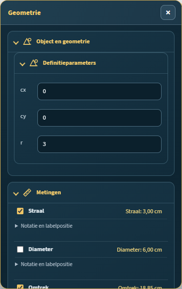
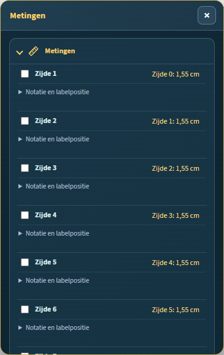

# WIE — GEO-UI validation and UX report

**Repository:** `Geert1985/wiskundige-illustratie-editor`
**Branch:** `codex/geo-ui-full-implementation`
**Starting HEAD:** `4a3abf0`
**Contract:** `docs/WIE-GEO-UI-Geometrie-en-Metingencontract-v1.1.0.md`
**Validation date:** 16 October 2026

## 1. Audit findings

The geometry inspector exposed legacy `Maat tonen` controls beside the new per-measurement controls for finite line segments, circles, angles, and dimensions. That left two ways to control labels, made the current visibility state ambiguous, and could render duplicate or conflicting labels.

The circle defaults also promoted legacy `showMeasurement: true` to all four new measurements. An older circle could therefore gain diameter, circumference, and area labels when its previous state meant only “show the radius.” The excentricity value was sent through the document length-unit formatter, which incorrectly appended a length unit to a dimensionless quantity.

The radial context filter handled top-level inspector sections but did not consistently update the new nested geometry and measurement groups. The Geometry, Measurement, and All choices could consequently leave the wrong group visible. The measurement details also had an unnecessary nested disclosure panel.

Adding the grouped controls exposed a DOM compatibility issue in phase-one inspector grouping: production code used `Element.append()`, while the supported wrapper interface only guarantees `appendChild()`. The browser had masked this until that section was rebuilt.

Several existing Edge checks still targeted the old controls and section order. Those were test-contract drift: they expected the free-text controls to be visible while collapsed, queried the legacy value element for new independent measurements, or expected Relations to precede the contract's geometry section.

## 2. Corrections

- Consolidated supported measures into compact rows with one visibility switch, a localized name, and the calculated value. Circle radius, diameter, circumference, and area each have independent visibility.
- Removed overlapping legacy controls for object types using independent measurements. Kept legacy fields and their meanings in saved documents; legacy circle visibility maps to radius only. Kept the existing vector norm control because vector measurements remain outside the implemented M7 vector milestone.
- Moved notation mode, precision, text, and label-position reset into each measurement's expandable detail. Each value keeps its own position and retains that position when hidden and shown again.
- Corrected the radial context filtering so Geometry shows the shared geometry and measurement groups, Measurement opens the same measurement settings, and All shows both groups. The three choices share one state.
- Applied dimensionless formatting to ellipse eccentricity and corrected the grouped inspector to use `appendChild()`.
- Bumped the editor asset cache token and updated pinned cache-token assertions to prevent stale browser assets.
- Updated legacy browser checks to operate the collapsed detail controls and to read values from the new measurement rows.
- Added Node and Edge regressions for independent circle states, units and numeric values, simultaneous labels, independent offsets, dynamic dependent circles, invalid-angle recovery, undo/redo, schema v10, import/export, and save/reopen.

## 3. Automated results

| Suite | Result |
|---|---:|
| `npm test` | **671 passed, 0 failed, 0 skipped** |
| `npm run test:edge` | **65 browser modules completed, 0 JavaScript page errors** |
| Focused GEO-UI Edge suite | **10 reported scenario groups passed, 0 JavaScript page errors** |
| Focused legacy measurement/label Edge suite | **10 reported scenarios passed, 0 JavaScript page errors** |
| Focused dynamic-angle Edge suite | **14 reported scenarios passed, 0 JavaScript page errors** |
| Focused axis-reference Edge suite | **18 reported scenarios passed, 0 JavaScript page errors** |
| Focused inspector-order Edge suite | **7 reported scenarios passed, 0 JavaScript page errors** |

The Node GEO-UI regressions cover all **16** circle visibility combinations. Supported finite objects covered in the browser include line segment, circle, angle, polygon, and ellipse. Straight and ray are explicitly verified to have no finite-length measurement controls or labels. The full Edge suite uses the installed Microsoft Edge channel (Edge 155, Playwright headless); its combined runner invokes **65** browser modules as one run.

The first full Edge attempts surfaced outdated assertions in the existing measurement, inspector-order, dynamic-angle, and axis-reference browser checks. Those checks were updated to the new inspector contract and rerun individually before the full suite passed.

## 4. Edge UI validation

The browser run checked the independent circle switches and displayed values (radius 3.00 cm, circumference 18.85 cm, and area 28.27 cm²), precision override, multiple visible labels, independent dragging and reset, radial Geometry/Measurement/All behavior, line segment and finite/infinite line-family behavior, polygon scrolling, dependent-circle recomputation, undo/redo, schema-v10 save/reload, JSON import, and page errors. The many-sided polygon panel measured `scrollHeight: 2144`, `clientHeight: 578`, with `overflow-y: auto`.

### Screenshots

The four original reference screenshots mentioned in the request were not present as image files in the repository or accessible attachment directory during this run. The updated screenshots document the final inspector; a pixel-by-pixel comparison with those original images was therefore not possible.

## 5. Limitations

- Infinite straight and ray objects intentionally expose no finite-length measurement.
- Vector component, norm, and direction measurements remain outside this work because the repository's M7 vector-measurement milestone is not implemented.
- Ellipse circumference is not offered; the contract requires a separate numeric-accuracy decision for that value.
- Edge checks ran on Microsoft Edge through Playwright's installed Edge channel in headless mode; no manual pointer-only exploratory pass was recorded.
- The report does not claim new underlying geometry algorithms beyond the measured values and object families named above.

## 6. Delivery

Changes are prepared on the existing `codex/geo-ui-full-implementation` branch. They are not merged to `main`.
