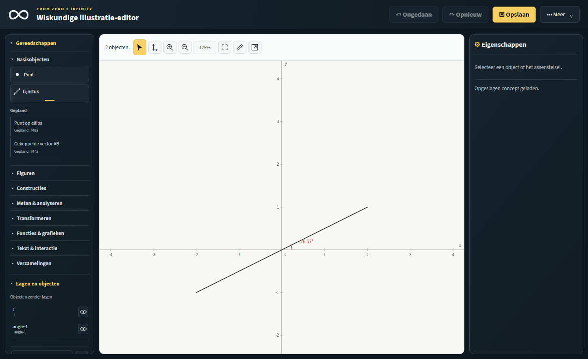
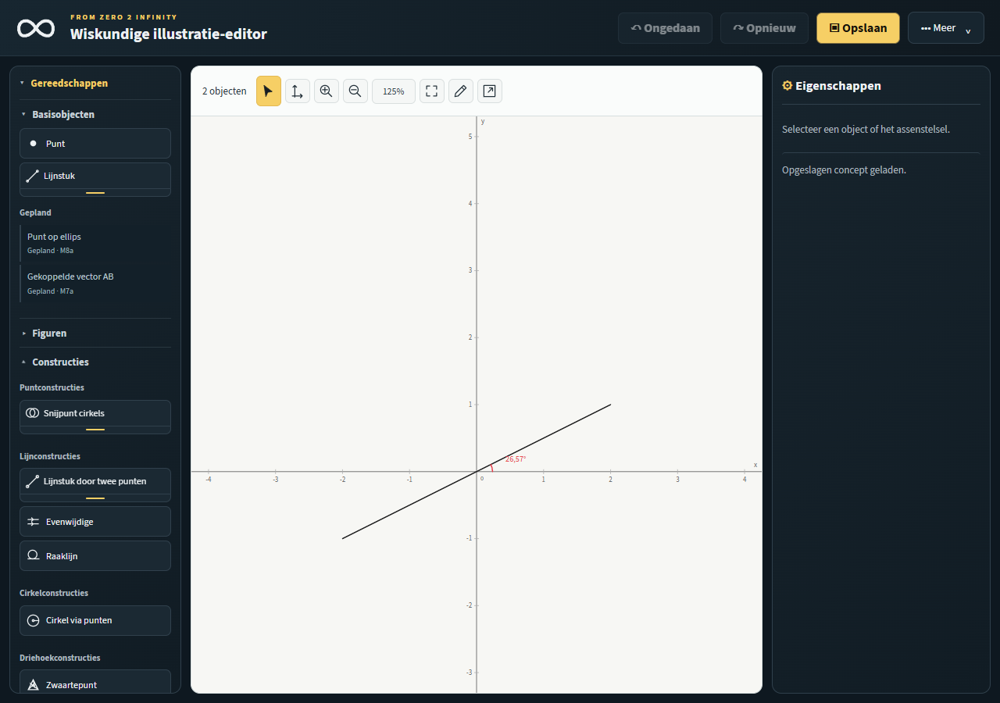
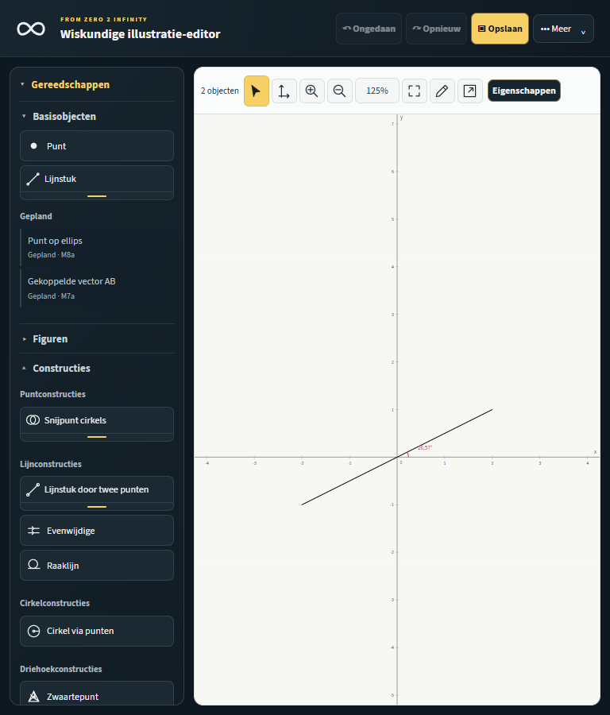
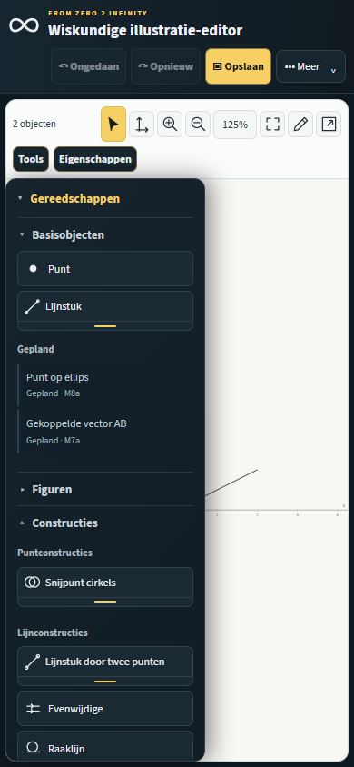

# Gereedschapspaneel — herstructurering

<!-- DOC-RADIAL-1: historical source note (2026-10-14) -->
> **Historisch implementatie-/testrapport (eerdere branch).** De beschreven categorieën, hoekenlocaties en tests horen bij de toenmalige `codex/tool-panel-reorganization`-mijlpaal. De actuele gereedschaps-/lagen-tabbladen, hoekgereedschappen onder **Vrije objecten**, contractgestuurde radiale constructies en het rechtsklikmenu staan in de [roadmap v2.8.0](DEVELOPMENT-ROADMAP.md), [UI-RADIAL-9](UI-RADIAL-9-CONTRACT-DRIVEN.md) en [AGENTS.md](../AGENTS.md). **Eerdere PASS-rapporten zijn geen automatisch testbewijs voor de nieuwe radiaalbranch.**

Versie: 1.0.0
Datum: 2026-10-12
Branch: `codex/tool-panel-reorganization`
Basis: `341de02be587b46ea91d1795670650bd609cac9a` (`chatgpt/m6a-triangle-centers`, gelijk aan de gepushte remote). Op expliciet verzoek is de nieuwste programmaversie gebruikt in plaats van de oudere `main`.

## Implementatie en afbakening

De bovenliggende rubriek heet nu **Gereedschappen**. Daaronder staan acht onafhankelijk inklapbare categorieën, met een verticale knoppenindeling. De afzonderlijke sectie **Lagen en objecten** blijft aanwezig. Native `details`/`summary`, de bestaande gedelegeerde toolhandlers, permissions, toolinstructies en actieve indicatoren blijven de bediening verzorgen.

Alle 32 bestaande gereedschap-ID's zijn precies één keer aanwezig in het paneel. Selecteren blijft apart in de canvasnavigatie. De drie reeds geïmplementeerde M6a-centra zijn werkende knoppen onder Driehoekconstructies; zij zijn geen placeholders. De constructies zelf, hun algoritmen, documentversie 7, constructionSchema 2, de T5a-rekenmotor en de opslag-/exportdiensten zijn niet gewijzigd.

Statische hoeken zijn uit het lineaire split-menu verplaatst naar een eigen split-menu onder Meten & analyseren. Dit gebruikt dezelfde controller en dezelfde bestaande `linear`-voorkeurskey; een eerder onthouden rechte hoek wordt bij heropenen behouden. Er zijn geen nieuwe opgeslagen UI-voorkeuren, zoekfunctie of favorieten toegevoegd. De M6a-centra staan nu rechtstreeks zichtbaar onder hun eigen subgroep, in plaats van in het algemene punt-split-menu.

De fullscreen-gereedschapskiezer wordt zoals voorheen uit de sidebar opgebouwd. Hij neemt ook de statische placeholders over. Deze krijgen nooit een `data-canvas-tool`, knop of tabstop.

## Voor en na; volledige mapping van werkende gereedschappen

Voorheen waren er Basisobjecten, Figuren, Meten en Constructies. Tekst en statische hoeken stonden bij Basisobjecten; de driehoekcentra stonden in het algemene puntconstructiemenu.

| Gereedschap-ID | Oude locatie | Nieuwe locatie |
| --- | --- | --- |
| `point` | Basisobjecten | Basisobjecten |
| `line`, `straight`, `ray`, `vector` | Basisobjecten / lineair split-menu | Basisobjecten / lineair split-menu |
| `triangle`, `polygon`, `circle` | Figuren | Figuren |
| `construct:midpoint`, `construct:pointOnSegment`, `construct:pointOnCircle` | Constructies / punt-split-menu | Constructies / Puntconstructies |
| `construct:lineIntersection`, `construct:lineCircleIntersection`, `construct:circleCircleIntersection` | Constructies / punt-split-menu | Constructies / Puntconstructies |
| `construct:perpendicular`, `construct:perpendicularBisector`, `construct:bisector`, `construct:lineBetweenPoints` | Constructies / lijn-split-menu | Constructies / Lijnconstructies |
| `construct:parallel`, `construct:tangent` | Constructies | Constructies / Lijnconstructies |
| `construct:circleByCenterPoint` | Constructies | Constructies / Cirkelconstructies |
| `construct:centroid`, `construct:circumcenter`, `construct:orthocenter` | Constructies / punt-split-menu | Constructies / Driehoekconstructies |
| `dimension`, `construct:perimeter`, `construct:area` | Meten / meet-split-menu | Meten & analyseren / meet-split-menu |
| `construct:anglePoints`, `construct:angleDirections` | Meten / hoek-split-menu | Meten & analyseren / hoek-split-menu |
| `angle`, `rightAngle` | Basisobjecten / lineair split-menu | Meten & analyseren / Hoeken tekenen en meten |
| `text` | Basisobjecten | Tekst & interactie |

Nieuwe categorieën Transformeren, Functies & grafieken en Verzamelingen bevatten uitsluitend toekomstige functies. De bestaande vier categorie-ID's blijven behouden; de overige vier zijn `transformeren`, `functies`, `tekst` en `verzamelingen`.

## Geplande placeholders en roadmapbewijs

Er zijn 38 statische placeholders. Elke rij noemt **Gepland** en de bijbehorende roadmapfase. Het zijn gewone tekstcontainers: geen `button`, `a`, invoer, `tabindex`, actieve tool-ID of eventhandler. Zij veranderen bij klikken geen document, selectie, tool, interactie, geschiedenis, status of storage.

| Categorie | Toekomstige functies | Bestaand planningsbewijs |
| --- | --- | --- |
| Basisobjecten (2) | Punt op ellips; gekoppelde vector AB | M8a `tasks-126`; M7a `tasks-147` |
| Figuren (3) | Ellips; parallellogram; regelmatige veelhoek | M8a/M8b `tasks-124`–`tasks-138` |
| Constructies (6) | Middelpunt ingeschreven cirkel; ingeschreven cirkel; Eulerlijn; negenpuntscirkel; meetkundige plaats; spoor van een bewegend punt | M6b `tasks-103`–`tasks-105`; M9 `tasks-153`–`tasks-154` |
| Meten & analyseren (2) | Vectoranalyse; functieanalyse van nulpunten, snijpunten en extrema | M7f `tasks-148`–`tasks-150`; M12 `tasks-182`; F03/F05 |
| Transformeren (7) | Spiegelen; verschuiven; roteren; uniform schalen; niet-uniform schalen; transformaties samenstellen; matrixtransformaties | M7 `tasks-119`–`tasks-121`, `tasks-140`–`tasks-143`; F03 |
| Functies & grafieken (10) | y=f(x); parametrische kromme; impliciete kromme; nulpunten; snijpunten van functies; extrema; raaklijn aan grafiek; afgeleide; bepaalde integraal; Riemannsom | M11/M12 `tasks-165`, `tasks-169`, `tasks-173`–`tasks-174`, `tasks-182`–`tasks-184`; F05 |
| Tekst & interactie (4) | Berekend tekstveld; parameter; schuifregelaar; puntanimatie | T5c `ti26-4027`; M13/M14; F06/F07 |
| Verzamelingen (4) | Venn-diagram; Eulerdiagram; interval op getallenlijn; verzameling in coördinatenvlak | `tasks-109`–`tasks-110`, `tasks-114`–`tasks-115`, `tasks-176`–`tasks-180` |

Bronnen: `docs/DEVELOPMENT-ROADMAP.md` v2.4.0 en `docs/FEATURE-BACKLOG.md` v1.6.0. Een generieke, niet afzonderlijk gespecificeerde tool “Analytische metingen” is niet verzonnen; de bevestigde analysefuncties zijn expliciet opgenomen. Alleen de reeds bestaande afgeleide cirkeltool `circleByCenterPoint` is functioneel opgenomen. Nieuwe cirkelalgoritmen of objecttypen zijn niet toegevoegd.

## Gewijzigde bestanden

- `editor.html`: categorieën, subgroepen, verplaatsing van bestaande knoppen, statische placeholders en één gezamenlijke cacheversie voor alle editorassets.
- `editor.css`: subgroepkoppen en niet-interactieve geplande rijen, inclusief fullscreenpresentatie.
- `editor.js`: split-menuconfiguratie en het overnemen van statische placeholders in de bestaande fullscreenkiezer.
- `tests/tool-panel-reorganization.test.cjs`: drie Node-regressies voor ID-behoud, inert DOM-contract en gekoppelde split-controls.
- `tests/browser-tool-panel-reorganization.cjs`: echte toolactivatie, onafhankelijke categoriebediening, inertheid sidebar/fullscreen, oude hoekvoorkeur en responsive screenshots.
- `tests/browser-split-tools.cjs`, `tests/browser-stacked-tools.cjs`, `tests/browser-canvas-fullscreen.cjs`: verwachtingen aangepast aan de nieuwe locaties/volgorde, met behoud van functionele controles.
- `tests/browser.cjs`: nieuwe regressiemodule opgenomen in de volledige suite.
- Dit rapport en vier screenshots in `docs/images/tool-panel-reorganization/`.

## Feitelijke verificatie

| Uitvoering | Resultaat |
| --- | --- |
| Volledige Node-suite: `node --test tests/*.test.cjs` | 585 geslaagd, 0 mislukt, 0 overgeslagen |
| Gerichte Edge-paneelmodule | 32 tools, 8 categorieën, 38 placeholders; sidebar- en fullscreeninertheid, toetsenbordcollapse en oude hoekvoorkeur geslaagd |
| Volledige Edge-suite: `node tests/browser.cjs` | Geslaagd: 54 regressiemodules plus de startup-/import-/exportcontroles; 0 paginafouten |
| `git diff --check` | Geslaagd |

De definitieve volledige Edge-run omvatte onder meer alle M6a-constructies, split-buttons, fullscreen, toolinstructies, eigenschappen, JSON/legacy, restricted permissies, rich-text en offline SVG/PNG-export. Ook de 73 rekencontractcases, 912 onafhankelijke afrondingsfixtures, 19 transcendentale referentiecases en 14 bronadaptercases slaagden.

De eerste Edge-start binnen de sandbox kon de browser niet starten. De tests zijn daarna buiten de sandbox gestart. De nieuwe werkboom miste eerst de reeds bestaande, door de PNG-regressie relatief ingeladen `pngjs`-dependency; die is vanuit de bestaande lokale werkboom naar de genegeerde dependencydirectory gekopieerd, zonder test- of productiecode te wijzigen. Een latere volledige run vond een gewijzigde UI-aanname: End in de fullscreenkiezer eindigde vroeger bij Raaklijn, nu bij Tekst. De verwachting is bijgewerkt en de aanwezigheid van Raaklijn wordt afzonderlijk gecontroleerd. De End-, Escape-, focus- en documentinvariantassertions zijn behouden. De assetcompatibiliteitstest wees bovendien terecht op mijn aanvankelijk gedeeltelijke cacheversiebump; alle editorassets gebruiken nu gezamenlijk `tool-panel-1`, zoals het bestaande releasecontract vereist. De test is ongewijzigd gebleven.

## Visuele controle en resterende acceptatie

De daadwerkelijk gemaakte screenshots zijn bekeken op 1280×900, 768×900 en 390×844; het afsluitende overzicht gebruikt 1446×884. De verticale knoppen blijven binnen het paneel; er is geen horizontale documentoverflow. Lange labels kunnen afbreken. De categorieën en placeholders gebruiken de bestaande donkerblauwe kleuren; goud blijft voor actieve bediening. Het paneel kan verticaal scrollen wanneer meerdere categorieën geopend zijn.

Nog handmatig te accepteren: de gewenste categorienamen/volgorde en visuele compactheid; bediening met een fysieke touchscreen en schermlezer; de ervaren scroll-/split-menubediening wanneer veel groepen openstaan. De geautomatiseerde pointer-, toetsenbord-, fullscreen-, constructie- en exportcontroles vervangen deze gebruikersacceptatie niet.

Er is niets naar `main` gemerged en geen nieuwe functionele milestone gestart. Wacht op visuele en functionele gebruikersacceptatie na deze UI-oplevering.
