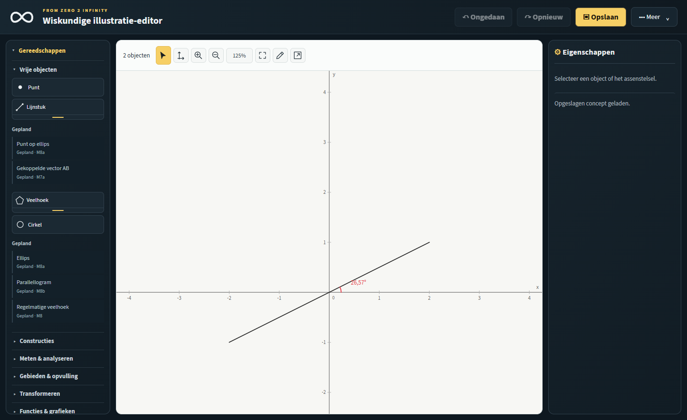
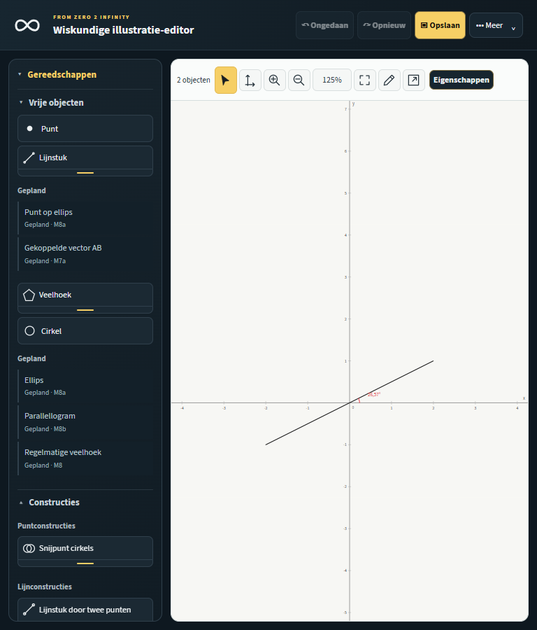

# UI-T1 — Gereedschapsindeling en catalogus

Versie: 1.0.0
Status: technisch afgerond; wacht op gebruikersacceptatie
Branch: `codex/ui-t1-tool-catalog`

## Resultaat

Het gereedschapspaneel heeft nu de acht afgesproken categorieën in deze volgorde: Vrije objecten, Constructies, Meten & analyseren, Gebieden & opvulling, Transformeren, Functies & grafieken, Tekst & interactie en Verzamelingen. De bestaande vrije cirkel-, driehoek- en veelhoektools staan bij Vrije objecten. De aparte Figuren-categorie is verwijderd. Alle 32 bestaande tool-ID’s en actieve M6a-constructies blijven behouden. Gebieden & opvulling bevat uitsluitend de bestaande inert vormgegeven REG-2-planningsitems.

De nieuwe `MI.ToolCatalog` bouwt één gevalideerde catalogus uit de declaratieve paneelmarkup. Hij bewaakt unieke categorie- en tool-ID’s, geldige splitgroepen en dat geplande tools geen actie- of command-ID kunnen krijgen. De zijbalk en fullscreenkiezer lezen dezelfde categorie-/tooldefinities. Splitmenu’s gebruiken hun catalogusmetadata voor bediening, toetsenbordnavigatie, paneelbegrenzing en opslagvoorkeuren. De bestaande opslagkey voor de hoekgereedschappen blijft `linear`; bestaande tool- en command-ID’s, permissiechecks, model, documentformaat, schema en export zijn niet gewijzigd.

## Gewijzigde bestanden

- `editor.html` — categorie-indeling, declaratieve splitmetadata en script-/assetversie.
- `editor.js` — catalogus voor splitmenu’s en fullscreenkiezer; verwijderen van de dubbele hardcoded splitcatalogus.
- `tool-catalog.js` — nieuwe catalogusvalidatie en gedeelde catalogus-API.
- `tests/architecture.test.cjs`, `tests/helpers.cjs`, `tests/lifecycle.test.cjs` — modulemanifest en testfixtures laden de nieuwe module in de echte laadvolgorde.
- `tests/tool-catalog.test.cjs` — validatie, gedeelde weergaven en inertheid van geplande entries.
- `tests/tool-panel-reorganization.test.cjs`, `tests/browser-tool-panel-reorganization.cjs`, `tests/browser-area-menu.cjs`, `tests/browser-split-tools.cjs`, `tests/browser-stacked-tools.cjs` — categorie-, ID-, splitmenu- en integratieverwachtingen bijgewerkt.
- `docs/images/ui-t1-tool-catalog/tool-panel-overview.png` en `tool-panel-tablet.png` — schermafbeeldingen uit de Edge-suite.
- `docs/UI-T1-REPORT.md` — dit implementatie- en testrapport.

## Validatie

- `node --test tests/*.test.cjs` — **587 geslaagd, 0 mislukt, 0 overgeslagen**.
- `npm run test:edge` — **geslaagd** in Microsoft Edge; geen paginafouten (`pageErrors: []`). De integratiecontrole voor UI-T1 passeerde alle 32 tool-ID’s zonder documentmutatie, controleerde de 8 categorieën en 41 inerte placeholders, dezelfde catalogus en ID’s in fullscreen, onafhankelijke toetsenbordbediening van categorieën, legacy-splitvoorkeur en desktop/tablet/mobiele layouts. De Edge-runner legde vier viewport-screenshots vast.
- `git diff --check` — geslaagd.

## Schermafbeeldingen

Desktopoverzicht uit de volledige Edge-suite:

Tabletweergave uit dezelfde Edge-suite:

Voor Edge is de projectgebundelde Playwright gebruikt. De geïsoleerde preflight-testmap miste aanvankelijk de vastgepinde `pngjs`-dependency; versie 7.0.0 uit de beschikbare runtime is alleen in de genegeerde `node_modules`-map gezet om de bestaande offline PNG-controles te kunnen uitvoeren. Er zijn geen dependencymanifesten of lockfiles aangepast.

## Compatibiliteit en grenzen

Er is geen documentmodel-, schema-, permissie-, geschiedenis-, opslag- of exportwijziging. De bestaande tool-ID’s en localStorage-voorkeuren zijn behouden. Geplande tools blijven niet-interactieve inhoud zonder focus- of tool-ID. G-TRI1 en alle CORE-1-geometrie-/oppervlakte-API’s zijn niet geïmplementeerd.

## Handmatige acceptatie

Graag in de echte app nog visueel beoordelen: categorievolgorde en vindbaarheid, Constructies en Meten & analyseren, lege/planningsstatus van Gebieden & opvulling, splitmenu’s en hun voorkeur na herladen, plus de fullscreenkiezer. De tests bewijzen gedrag en layoutgrenzen; ze vervangen deze gebruikersacceptatie niet.
